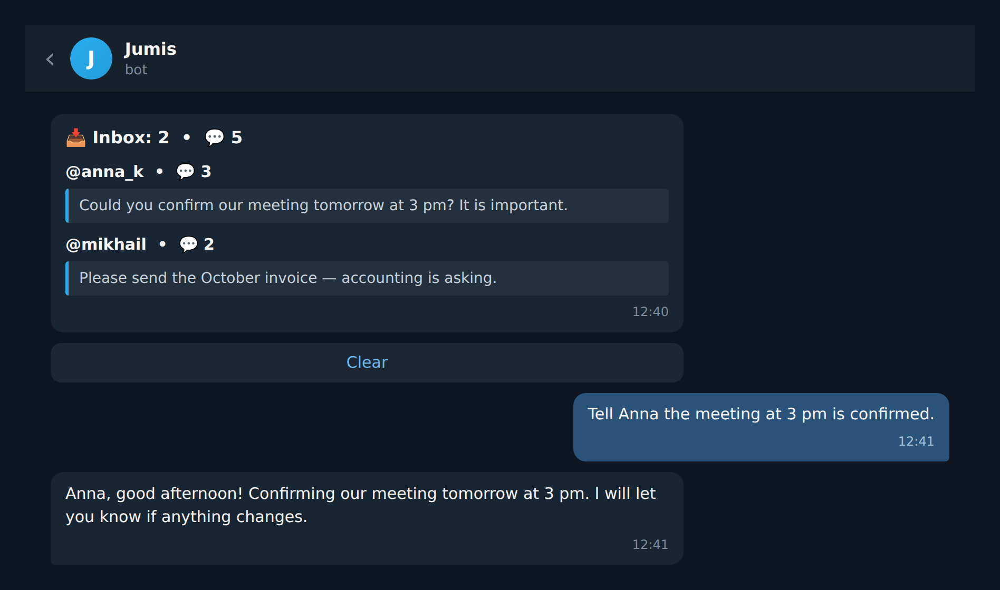
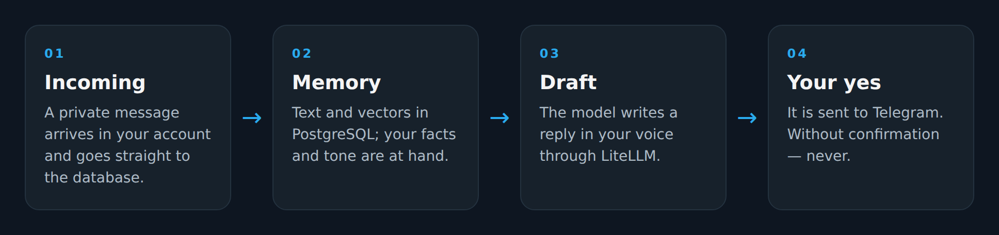

**English** · [Русский](README.ru.md)

# Jumis

Jumis is a personal secretary inside Telegram. It lives in your account: it reads your private chats,
keeps them in your own database and finds what you need by meaning, not by date.

It replies with you, not instead of you. You dictate what to say, it drafts the answer in your
style, shows it — and sends only after your yes. There is no autopilot: it never messages anyone
without your permission.

It shines where replies are long or repetitive: a secretary for a founder, a manager, a craftsman.
Explain once how you talk to clients — after that it writes in your voice and you only approve.

It also keeps an eye on your inbox: who wrote, how many messages are waiting, what is new. Replied —
removed from the queue; not needed — cleared.



*Illustration: the inbox widget in a chat.*

## What it can do

- replies in your style and sends only when you ask;
- keeps your inbox under control: who is waiting for an answer and for how long;
- remembers facts, agreements and your tone of voice — and brings them up when needed;
- reminds you about meetings, dates and birthdays, sets alarms and recurring tasks;
- collects news from your RSS feeds and writes a digest with source links;
- searches your whole chat history by meaning;
- works with any model LiteLLM supports: add the key, pick the model in the admin panel;
- looks after the database at night: cleans junk, compresses old conversations, makes a backup.

## Stack

| Layer | What |
| --- | --- |
| Language | Python 3.12 |
| Telegram | `aiogram` — the owner bot, `telethon` — your account |
| Models | `litellm` — DeepSeek by default, others via API key |
| Database | PostgreSQL 17 + `pgvector` |
| Search and memory | `sentence-transformers`, `multilingual-e5-base`, 768 dimensions |
| Speech | `kairos-asr`, local, on GPU |
| Runtime | `docker compose`: the bot and the database in containers |

> An NVIDIA GPU is required for now: the speech model loads at startup. On a GPU transcription is
> instant. A CPU mode is planned; forks are welcome.

## Installation

```bash
git clone https://github.com/shliamb/Jumis.git
cd Jumis
./install.sh
```

The script checks Docker and the GPU, then asks for the bot token, `admin_id`, `api_id` and `api_hash`
from [my.telegram.org](https://my.telegram.org), and LLM keys. Enter keeps the current value or skips
the step; running it again is safe and does not overwrite what you entered. Manual path: copy `.env.example` → `.env` and
`.env.llm.example` → `.env.llm`, then `docker compose up -d --build`.

## First start

1. Send `/start` to the bot — it remembers you as the owner.
2. Send `/login` and confirm in the Telegram app (QR link or code). If the account is not connected
   yet, the bot offers this itself.
3. That's it. Tables are created automatically; after that just talk.

## How to use it

There are no commands for the agent: you just type or speak, like to a person. It decides what to do —
search the history, save a fact, set a reminder, send a message.

The admin panel is separate: `/admin` shows the userbot status and the full list of service commands.
The list keeps growing, so there is nothing to memorise.

## Under the hood



- All conversations and memories are vectorised: things are found by meaning, not by keywords.
- Memory is pulled into every answer and extended by the agent as you talk.
- At night it cleans junk, compresses old conversations into digests and backs up the database. From
  the admin panel you can export and import tables as JSON by category.

Limits: one owner, private chats only. It never answers anyone by itself — sending always follows
your confirmation.
