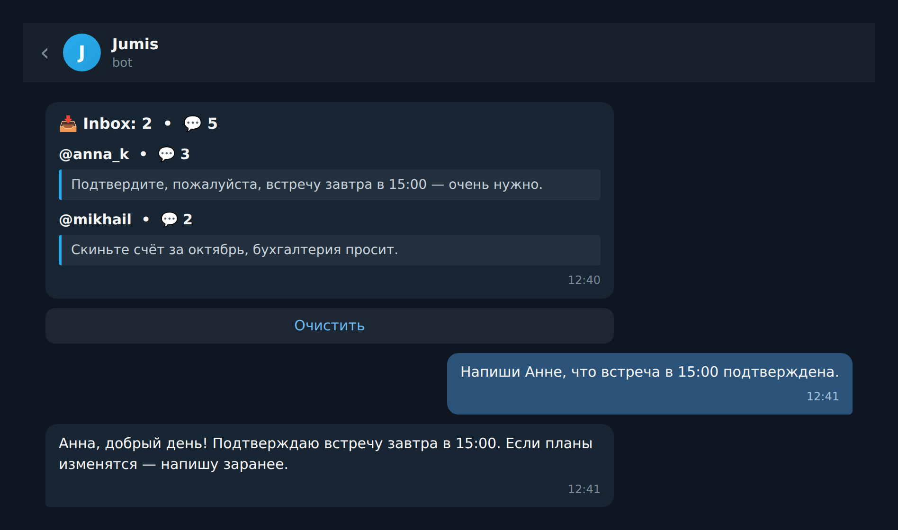
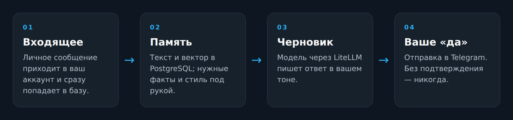

[English](README.md) · **Русский**

# Jumis

Jumis — личный секретарь в Telegram. Он живёт в вашем аккаунте: читает личные переписки, складывает
их в вашу собственную базу и находит нужное по смыслу, а не по дате.

Отвечает он не вместо вас, а вместе с вами. Вы наговариваете голосом, что нужно ответить, он
собирает ответ в вашем стиле, показывает — и отправляет только после вашего «да». Автоответчика в
нём нет: без вашего разрешения он не напишет никому.

Удобен там, где ответы длинные или повторяются: секретарь для предпринимателя, менеджера, мастера.
Один раз объяснили, как вы разговариваете с клиентами, — дальше он пишет в вашем тоне, а вы только
подтверждаете.

Ведёт ваши входящие: кто написал, сколько сообщений ждёт ответа, что новое. Ответили — снял с
очереди, не нужно — очистили.



*Иллюстрация: виджет входящих в чате.*

## Что умеет

- отвечает в вашем стиле и отправляет только по вашей команде;
- держит входящие под контролем: кто ждёт ответа и сколько;
- помнит факты, договорённости и стиль общения — и достаёт их в нужный момент;
- напоминает о встречах, датах и днях рождения, ставит будильники и повторяющиеся задачи;
- собирает новости из ваших RSS-фидов и делает сводку со ссылками на источники;
- ищет по всей истории переписки по смыслу;
- работает с моделями, которые поддерживает LiteLLM: вставили ключ — выбрали модель в админке;
- ночью сам следит за базой: чистит мусор, сжимает старую переписку, делает бэкап.

## Стек

| Слой | Что |
| --- | --- |
| Язык | Python 3.12 |
| Telegram | `aiogram` — бот владельца, `telethon` — ваш аккаунт |
| Модели | `litellm` — DeepSeek по умолчанию, остальные подключаются ключом |
| База | PostgreSQL 17 + `pgvector` |
| Поиск и память | `sentence-transformers`, `multilingual-e5-base`, 768 измерений |
| Речь | `kairos-asr` локально, на GPU |
| Запуск | `docker compose`: бот и база в контейнерах |

> Видеокарта NVIDIA пока обязательна: распознавание речи грузится при старте. На GPU транскрибация
> занимает мгновения. Режим CPU — в планах, форк приветствуется.

## Установка

```bash
git clone https://github.com/shliamb/Jumis.git
cd Jumis
./install.sh
```

Скрипт проверит Docker и видеокарту, спросит токен бота, `admin_id`, `api_id` и `api_hash` с
[my.telegram.org](https://my.telegram.org) и ключи LLM. Enter оставляет текущее значение или
пропускает шаг; повторный запуск безопасен и не затирает введённые значения. Вручную: скопировать
`.env.example` → `.env` и `.env.llm.example` → `.env.llm`, затем `docker compose up -d --build`.

## Первый запуск

1. Отправьте боту `/start` — он запомнит вас как владельца.
2. Отправьте `/login` и подтвердите вход в приложении Telegram (QR-ссылка или код). Если аккаунт
   ещё не подключён, бот сам предложит это сделать.
3. Всё. Таблицы создаются автоматически, дальше — просто переписка.

## Как этим пользоваться

Команд для работы с агентом нет: вы просто пишете или говорите голосом, как живому человеку. Он сам
решает, что сделать — поискать в истории, записать факт, поставить напоминание, отправить сообщение.

Админка отдельно: `/admin` показывает состояние userbot и весь список служебных команд. Список
пополняется, запоминать его не нужно.

## Под капотом



- Вся переписка и память векторизуются: нужное находится по смыслу, а не по ключевым словам.
- Память подтягивается в каждый ответ и дополняется агентом по ходу общения.
- Ночью — уборка мусора, сжатие старых переписок в дайджесты и бэкап базы. В админке — выгрузка и
  загрузка таблиц в JSON по категориям.

Ограничения: один владелец, только личные чаты. Сам никому не отвечает — отправка всегда после
вашего подтверждения.
